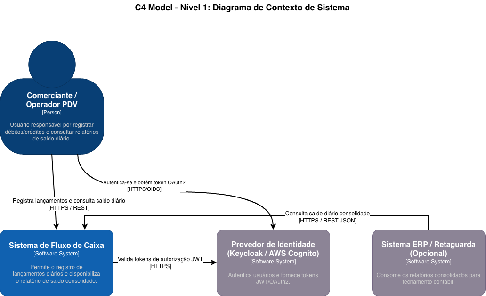
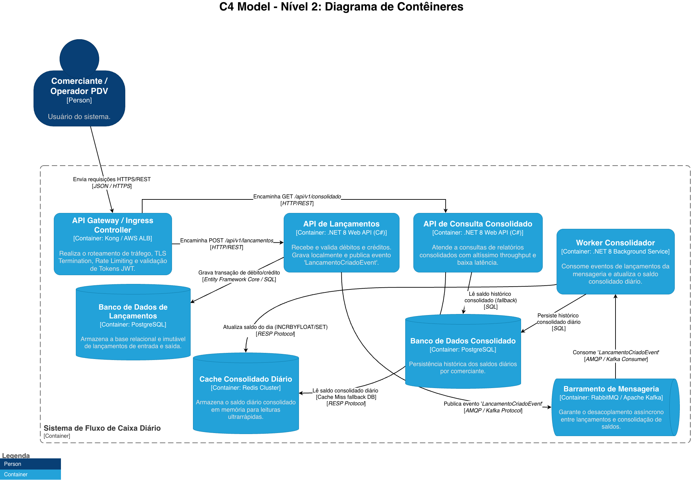
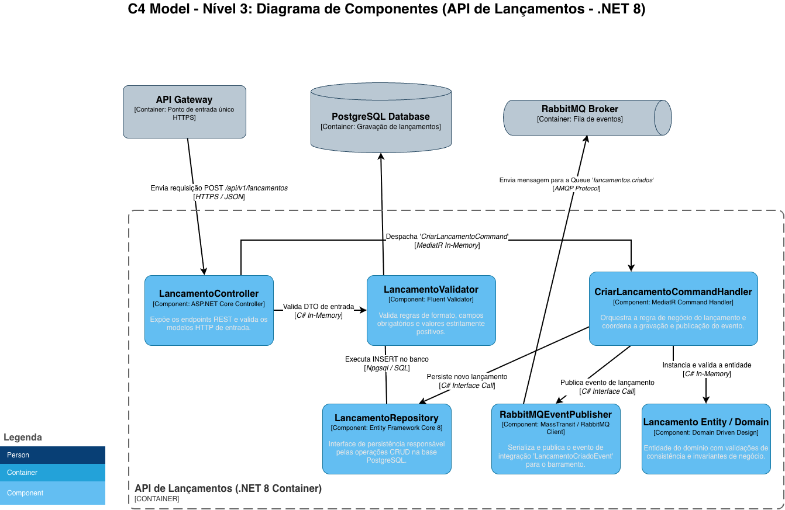

# Guia Executivo: Arquitetura da Solução de Controle de Fluxo de Caixa e Consolidado Diário

---

## 📋 Índice

1. [Resumo Executivo](#1-resumo-executivo)
2. [Estudos Realizados & Matriz de Decisão Tecnológica](#2-estudos-realizados--matriz-de-decisão-tecnológica)
3. [Visão Geral da Arquitetura de Solução](#3-visão-geral-da-arquitetura-de-solução)
4. [Representação Arquitetural (C4 Model Executivo)](#4-representação-arquitetural-c4-model-executivo)
5. [Resiliência, Escalabilidade & Garantia de SLA](#5-resiliência-escalabilidade--garantia-de-sla)
6. [Estratégia de Transição & Migração do Legado (Strangler Fig + CDC)](#6-estratégia-de-transição--migração-do-legado-strangler-fig--cdc)
7. [Análise Financeira & FinOps (TCO Cloud)](#7-análise-financeira--finops-tco-cloud)
8. [Governança, Observabilidade & Segurança](#8-governança-observabilidade--segurança)
9. [Conclusão & Próximos Passos](#9-conclusão--próximos-passos)

---

# 1. Resumo Executivo

Este documento apresenta a especificação executiva da arquitetura de solução desenvolvida para atender à necessidade estratégica de controle de fluxo de caixa e geração de saldo diário consolidado para comerciantes.

## O Desafio de Negócio

- **Serviço de Lançamentos:** Alta disponibilidade crítica para garantir que toda operação de crédito ou débito seja registrada com baixa latência e sem perda de dados.
- **Serviço de Consolidado Diário:** Necessidade de processamento de picos de carga (50 requisições/segundo) com tolerância máxima de 5% de perda ou degradação.
- **Isolamento de Falhas (SLA Crítico):** O serviço de lançamentos não pode ficar indisponível em caso de queda ou manutenção do sistema de consolidação.

## A Solução Proposta

Uma arquitetura desacoplada e orientada a eventos (**Event-Driven Architecture - EDA**) desenvolvida em **.NET 8 (C#)**, utilizando **Clean Architecture**, **Domain-Driven Design (DDD)** e **CQRS**. O ecossistema é complementado por mensageria assíncrona (**RabbitMQ/Kafka**) para amortecimento de picos e cache de alta performance (**Redis**) para consultas instantâneas.

---

# 2. Estudos Realizados & Matriz de Decisão Tecnológica

Para fundamentar a escolha da pilha tecnológica, foi realizada uma análise comparativa entre **.NET 8 (C#)**, **Java 21 (Spring Boot / Quarkus)** e **Python 3.12 (FastAPI)**.

## Matriz Comparativa de Arquitetura e Performance

| Critério                      | Java 21 (Spring Boot) | .NET 8 (C#)       | Python 3.12 (FastAPI) | Requisito     |
|-------------------------------|-----------------------|-------------------|-----------------------|---------------|
| Latência P99 (Escrita HTTP)   | ~25 ms                | **~12 ms**        | ~45 ms                | < 100 ms      |
| Throughput (Consumo de Fila)  | Alto                  | **Altíssimo**     | Moderado              | ≥ 50 req/s    |
| Consumo de RAM por réplica    | 250-450 MB            | **120-180 MB**    | 90-150 MB             | Menor TCO     |
| Tempo de Startup              | 3-5s                  | **~0.8s**         | ~1.1s                 | Elasticidade  |
| Ecossistema                   | Excelente             | **Excelente**     | Médio                 | Produtividade |

## Justificativa Executiva pela Escolha do .NET 8

1. **Eficiência Financeira (FinOps):** menor consumo de infraestrutura por contêiner.
2. **Servidor Kestrel de Alta Performance:** elevado throughput com processamento assíncrono.
3. **Native AOT:** inicialização rápida e redução de overhead operacional.

---

# 3. Visão Geral da Arquitetura de Solução

A solução adota segregação clara de responsabilidades baseada em **DDD** e **Bounded Contexts**.

```text
[ Cliente / Comerciante ]
           |
           v
[ API Gateway ] -- OAuth2/JWT + Rate Limiting
           |
     +-----+-----------------------+
     |                             |
     v                             v
[ Lançamento Service ]   [ Consolidado Query API ]
           |                        |
           v                        v
 [ PostgreSQL Escrita ]      [ Redis Cache ]
           |
           v
 [ RabbitMQ / Kafka ]
           |
           v
 [ Consolidado Worker ]
           |
           +----> Redis
           |
           +----> PostgreSQL Histórico
```

---

# 4. Representação Arquitetural (C4 Model Executivo)

## Nível 1: Diagrama de Contexto

- Atores: Comerciante e ERP Interno.
- Sistema Principal: Plataforma de Gestão de Caixa.
- Sistema Externo: Provedor de Identidade (OAuth2/OIDC).

<h3>Diagrama de Contexto</h3>



## Nível 2: Diagrama de Contêineres

1. API Gateway.
2. CashFlow.API (.NET 8).
3. Message Broker (RabbitMQ/Kafka).
4. CashFlow.Worker (.NET 8).
5. PostgreSQL + Redis.

<h3>Diagrama de Contêineres</h3>


## Nível 3: Diagrama de Componentes

- **Presentation:** Controllers e Middlewares.
- **Application:** Commands, DTOs, Handlers e Eventos.
- **Domain:** Entidades e regras de negócio.
- **Infrastructure:** Persistência, mensageria e cache.

<h3>Diagrama de Componentes</h3>


---

# 5. Resiliência, Escalabilidade & Garantia de SLA

## Garantia de Não-Indisponibilidade do Lançamento

- Não existe dependência síncrona do consolidado.
- Lançamentos continuam sendo aceitos mesmo com indisponibilidade do consolidado.

## Absorção de Picos de Carga

- RabbitMQ/Kafka atua como buffer de carga.
- Workers processam eventos de forma assíncrona e paralela.

## Tolerância a Falhas

- Retry com Exponential Backoff e Jitter.
- Dead Letter Queue (DLQ).
- Idempotência baseada em chaves de processamento.

---

# 6. Estratégia de Transição & Migração do Legado (Strangler Fig + CDC)

1. Introduzir API Gateway à frente do monolito.
2. Configurar CDC via Debezium.
3. Implantar nova API de Consolidado consumindo eventos.
4. Migrar endpoint de lançamentos para o novo microsserviço.
5. Realizar desativação gradual do legado.

---

# 7. Análise Financeira & FinOps (TCO Cloud)

| Componente                | Recurso               | Custo Mensal      |
|---------------------------|-----------------------|-------------------|
| Kubernetes (EKS/AKS)      | 3 nós com autoscaling | ~US$ 120          |
| RabbitMQ/Kafka Gerenciado | Mensageria            | ~US$ 80           |
| PostgreSQL Gerenciado     | Multi-AZ              | ~US$ 90           |
| Redis                     | Cache Distribuído     | ~US$ 45           |
| API Gateway + WAF         | Segurança             | ~US$ 35           |
| **Total**                 |           -           | **~US$ 370/mês**  |

**Licenciamento:** Stack totalmente Open Source.

---

# 8. Governança, Observabilidade & Segurança

## Segurança

- OAuth2/OIDC com JWT.
- TLS 1.3 e mTLS.
- Proteção contra OWASP Top 10.
- Segregação de acessos baseada em papéis.

## Observabilidade

### Métricas

- Latência.
- Throughput.
- Taxa de erro.

### Logs

- JSON estruturado.
- CorrelationId.

### Tracing Distribuído

- OpenTelemetry.
- Jaeger ou Grafana Tempo.

---

# 9. Conclusão & Próximos Passos

A solução proposta atende aos requisitos de disponibilidade, escalabilidade, resiliência e custo, garantindo que o processo de lançamento permaneça operacional mesmo diante de falhas ou picos de carga.

## Evoluções Futuras Recomendadas

1. Implementação de Event Sourcing.
2. Estratégia Multi-Region e Disaster Recovery.
3. KEDA para escalabilidade automática baseada em eventos.
